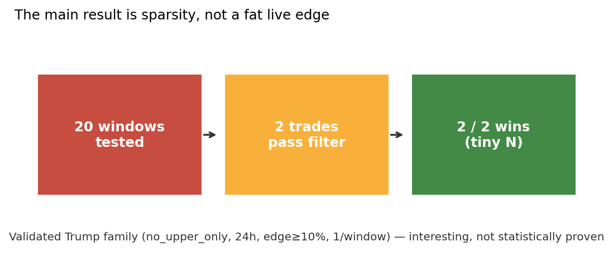
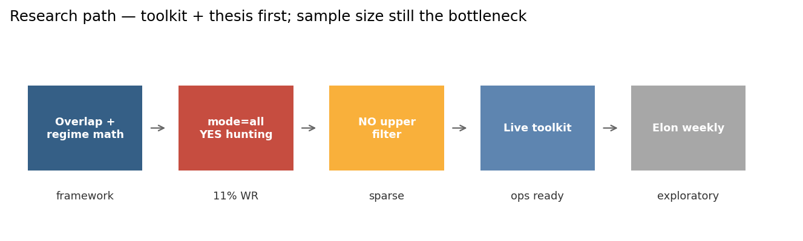
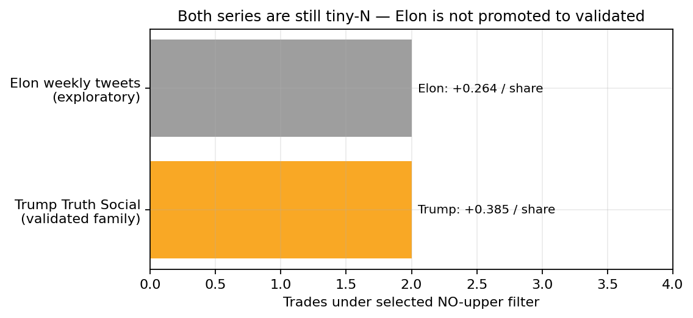
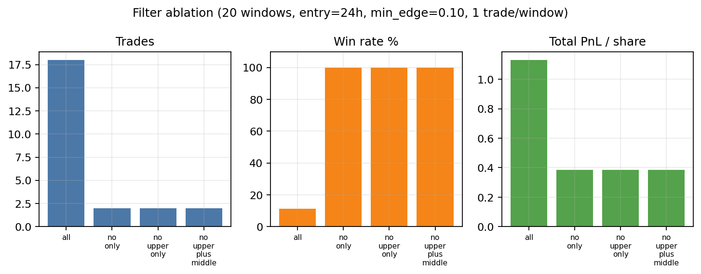
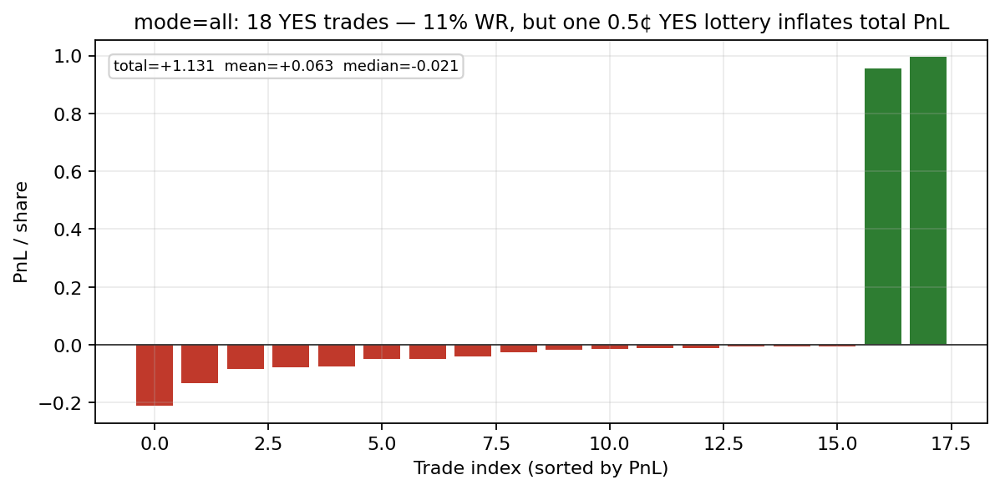
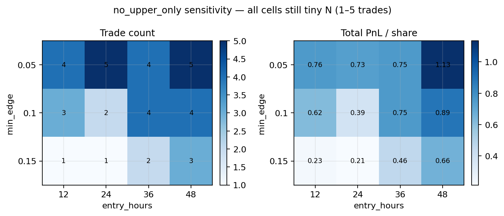

# Research Note: Polymarket Post-Count Markets (Truth Social / Elon)

**Author:** ron1n97  
**Status:** portfolio research write-up — **weakest empirical sample** of the Polymarket series  
**Stack:** Python, XTracker counts, Polymarket Gamma + CLOB history, live signal toolkit  
**Code:** this repository

---

## Abstract

I built a regime / arithmetic framework for Polymarket **overlapping weekly post-count** markets (Trump Truth Social; exploratory Elon tweet weeklies). The useful idea is not “forecast the exact total,” but translate each bin into a **required posts/day** on remaining time and fade upper bins that still need a sustained spike while the market prices them as central.

**Honest headline:** under the historically preferred live family (`NO` on upper bins only, ~24h after open, min edge 10%, one trade per window) the Trump backtest on **20** closed windows produces only **2** trades — both winners (**+0.385** PnL/share total). That is **interesting and operationally clean**, not a statistically proven income strategy. Broad `mode=all` takes **18** mostly-YES trades with **11%** win rate; total PnL stays positive only because of a **lottery skew** (one near-zero YES that paid ~+1).

Elon weekly support is **exploratory** (7 weekly windows matched; same tiny-N pattern).



---

## 1. Market structure

Series studied:

- Trump: `donald-trump-of-truth-social-posts-*` (Truth Social via XTracker)
- Elon: weekly `elon-tweets` windows (exploratory)

Windows **overlap**. Adjacent markets share day blocks, so prices that treat them as independent weekly totals are often wrong. Resolution follows XTracker-style counting (reposts / quotes matter; spikes move prices faster than fair value).

Core translation for bin `[L, H]`:

- `need_low = max(L - current_total, 0)`
- `req_low = need_low / days_remaining` (same for high)

Map required rate to crude regimes: quiet / base / active / spike. Trade when market-implied odds disagree with that regime map.



---

## 2. What “validated” means here

In this repo, **validated** means: a trade family that survived historical filters and was wired into the live CLI defaults — **not** “large-N proven alpha.”

Selected Trump defaults (`scripts/live_signal.py`):

| Knob | Value |
|---|---|
| Family | `no_upper_only` (`NO` on `80-99`, `100-119`) |
| Entry | first observation ≥ ~24h after window start |
| Min model edge | 0.10 |
| Cap | 1 strongest trade per window |

Backtest (20 closed windows, CLOB history + XTracker):

| Metric | Value |
|---|---|
| Windows tested | **20** |
| Trades | **2** |
| Wins | **2** |
| Win rate | **100%** (on n=2) |
| Total PnL / share | **+0.385** |
| Avg PnL / trade | **+0.193** |

Both trades were `NO 100-119` in Sep/Oct 2026 windows. Treat 100% WR as a **red flag for sample size**, not a trophy.



---

## 3. Ablations — why the filter exists

Same 20 windows, entry=24h, min_edge=0.10, max 1 trade/window:

| Mode | Trades | Win rate | Total PnL / share |
|---|---|---|---|
| `all` | 18 | 11.1% | +1.131 |
| `no_only` | 2 | 100% | +0.385 |
| **`no_upper_only` (selected)** | **2** | **100%** | **+0.385** |
| `no_upper_plus_middle` | 2 | 100% | +0.385 |



`mode=all` is almost entirely **YES**. Win rate collapses; total PnL is propped up by skew:



One YES entered near **0.5¢** and paid ~**+0.995**. Median trade in that set is still a small loss. **Do not** promote `all` as the live family.

Sensitivity on `no_upper_only` (entry hours × min edge) never escapes tiny N — cells are **1–5** trades, still often 100% WR:



Loose edges (`min_edge=0.05`, entry 24–48h) add a few more trades and more total PnL, but the story remains **sparse selective NO**, not a high-throughput system.

---

## 4. Elon weekly (exploratory)

`ELON_WEEKLY.md` / `scripts/elon_*` are intentionally **not** promoted to the same status as Trump.

Exploratory `no_upper_only` run (weekly windows only; 15 requested → **7** matched): **2** trades, **2** wins, **+0.264** PnL/share. Same pathology: filter fires rarely; perfect WR means almost nothing.

Next step before validation: longer sample, confirm a stable trade family, only then share live defaults with Trump.

---

## 5. Ops toolkit (what is actually strong)

Even with weak statistics, the repo is a clean **research → signal → size → snapshot** loop:

1. `live_signal.py` / `daily_run.py` — current preferred Trump (+ Elon exploratory) printout  
2. `position_size.py` — bankroll → simple share plans  
3. `truth_social_rank.py` — full ranking with mode / window flags  
4. `truth_social_snapshot.py` — JSONL state for later analysis  
5. `backtest_truth_social_baseline.py` (+ sensitivity) — historical filter tests  

That operational clarity is the portfolio asset. The missing asset is **sample size**.

---

## 6. What this is / is not

**Is:** a curated note on overlapping post-count market microstructure, a selective `NO`-upper thesis, honest tiny-N backtests, and a usable daily toolkit.

**Is not:** a claim of durable live alpha; a high-frequency weather/BTC-scale evidence pack; or a finished Elon strategy.

Compared with sibling repos:

| Repo | Evidence strength |
|---|---|
| polymarket-btc-5m-research | Strong negative-result economics story |
| polymarket-weather-research | Larger edge backtest + clear regime hierarchy |
| **this repo** | Strong framework, **weak N** |

---

## 7. Takeaways

1. **Overlapping windows + required-rate math** are the right abstraction.  
2. **Unfiltered YES hunting looks profitable until you see the lottery skew.**  
3. **Validated live defaults = sparse NO upper** — clean, not proven.  
4. **n=2 at 100% WR is a warning label**, not a pitch.  
5. Elon stays exploratory until the sample grows.

---

## Reproduce

```bash
pip install -r requirements.txt
python scripts/make_figures.py

# network required — historical XTracker + CLOB
python scripts/backtest_truth_social_baseline.py \
  --windows 20 --entry-hours 24 --min-edge 0.10 \
  --max-trades-per-window 1 --mode no_upper_only
```

Figures rebuild from `results/` without re-hitting the APIs.
